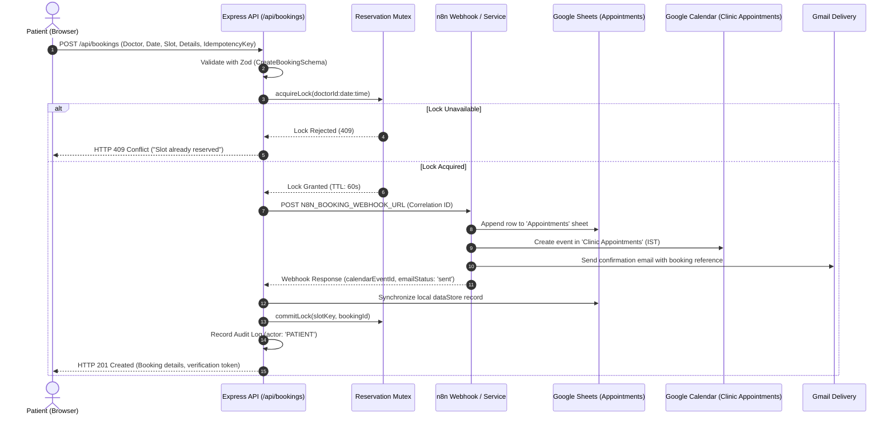

# Aura Health Clinic — System Architecture Documentation

## 1. Executive Architecture Summary

The Aura Health Clinic booking platform is an enterprise-grade medical appointment scheduling solution built with:
- **Patient Frontend (`apps/patient-web`)**: Modern React + Vite + TypeScript web application with warm editorial typography, reassuring micro-interactions, WCAG 2.2 AA accessibility, and a 7-step guided appointment booking wizard.
- **Clinical Admin Dashboard (`apps/admin-web`)**: High information-density React + Vite + TypeScript operational console with JWT authentication, real-time metrics, appointment search/filters/sorting/pagination, cancellation/reschedule actions, and doctor schedule configuration.
- **Backend API (`apps/api`)**: Modular Node.js + Express + TypeScript service incorporating Zod schema validation, Helmet security headers, CORS allowlisting, rate limiting, and structured audit logging.
- **Shared Package (`packages/shared`)**: Single source of truth for TypeScript interfaces, Zod runtime validators, and API response types.
- **Integrations**: n8n workflow automation orchestration connecting Google Sheets (`Clinic Booking Database`), Google Calendar (`Clinic Appointments`), and Gmail confirmations & reminders.

---

## 2. Monorepo Structure

```text
hosipital/
├── apps/
│   ├── patient-web/        # Public Patient Website (Vercel deployment)
│   │   ├── src/
│   │   │   ├── api/        # Typed API client
│   │   │   ├── components/ # Navbar, Footer, UI elements
│   │   │   ├── pages/      # Home, Doctors, Services, Booking (7 steps), Manage, Contact, 404
│   │   │   └── styles/     # Warm Ivory & Deep Teal design system tokens
│   │   └── index.html
│   ├── admin-web/          # Clinical Operations Console (Vercel deployment)
│   │   ├── src/
│   │   │   ├── api/        # Authenticated Admin API client
│   │   │   ├── context/    # Auth context & state
│   │   │   ├── components/ # Admin sidebar, header, operational layout
│   │   │   ├── pages/      # Login, Dashboard, Appointments, Doctors, Audit Logs
│   │   │   └── styles/     # Slate & Teal operational tokens
│   │   └── index.html
│   └── api/                # Express & TypeScript Backend API (Render deployment)
│       ├── src/
│       │   ├── config.ts
│       │   ├── controllers/# Booking, Doctor, Admin controllers
│       │   ├── middleware/ # Auth, rateLimiter, errorHandler
│       │   ├── routes/     # Public & Admin route definitions
│       │   ├── services/   # n8n, calendar, email, audit services
│       │   ├── store/      # Data store & Concurrency Reservation engine
│       │   └── utils/      # Slot calculation algorithms
│       └── test/           # 26 automated unit & integration tests
├── packages/
│   └── shared/             # Shared Types, Zod Schemas & API contracts
├── docs/                   # Comprehensive architectural & operational guides
├── .env.example            # Environment variables template
└── package.json            # Root npm workspaces configuration
```

---

## 3. Concurrency Control & The Google Sheets Limitation

### The Problem
Google Sheets is designed as an operational data store and tabular reporting tool. Because it relies on a read-then-append pattern without native row-level write locks, two simultaneous patient booking requests for the exact same doctor and slot time could both read the sheet as "free", and both append a new row, resulting in a double-booking.

### The Solution: Two-Phase Atomic Mutex with TTL
The backend implements an in-memory transactional reservation store (`ReservationStore`):
1. **Key Space**: Slots are identified by the tuple `${doctorId}:${appointmentDate}:${appointmentTime}`.
2. **Lock Acquisition (Phase 1)**: Before writing to Google Sheets or invoking downstream n8n workflows, the server executes `acquireLock(slotKey, holderId, ttlMs = 60000)`. If another request holds the lock or the slot is already committed, the second request fails immediately with HTTP 409 Conflict (`SLOT_CONCURRENT_CONFLICT` or `SLOT_UNAVAILABLE`).
3. **Commit Lock (Phase 2)**: Once the appointment is successfully created, the lock is committed permanently with the unique `bookingId`.
4. **Automatic Release**: If downstream operations fail, the lock is freed immediately, making the slot available for other patients.
5. **Idempotency Protection**: Requests with an `idempotencyKey` cache the confirmation payload for 24 hours. If a user double-clicks submit or retries on a flaky mobile network, the server returns the existing confirmed booking without creating duplicate rows or sending repeated emails.

---

## 4. End-to-End Booking Data Flow



---

## 5. Security Architecture

1. **Authentication**: Admin operations require cryptographic JWT signatures (`requireAdminAuth`). Tokens are generated using `HS256` with expiration.
2. **Authorization**: Public users can only view active doctors, check slot availability, create bookings, or manage their own specific booking with a cryptographic `verificationToken` or registered email.
3. **Rate Limiting**:
   - Booking Creation: 30 requests / 15 minutes per IP.
   - Admin Login: 15 requests / 15 minutes per IP.
   - General API: 120 requests / minute per IP.
4. **Security Headers**: Powered by `helmet()`, enforcing Content Security Policy, X-Frame-Options, DNS prefetch control, and HSTS.
5. **CORS Isolation**: Strictly whitelists `PATIENT_APP_ORIGIN` and `ADMIN_APP_ORIGIN`.
6. **Data Minimization**: Passwords, full webhook payloads, and sensitive medical notes are stripped from audit logs.
